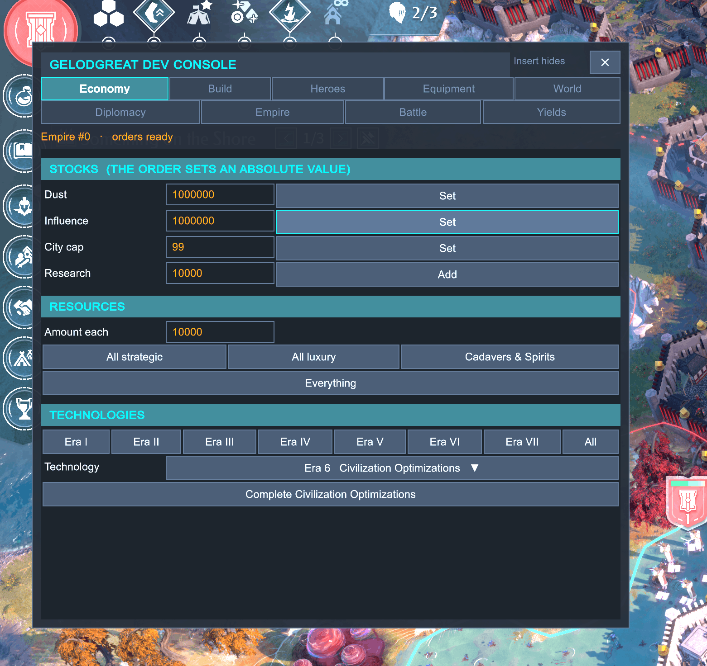
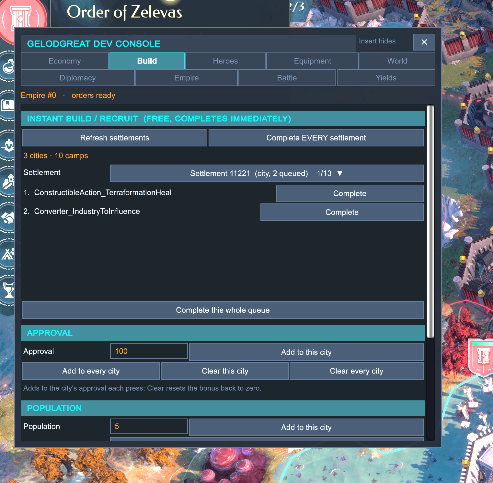
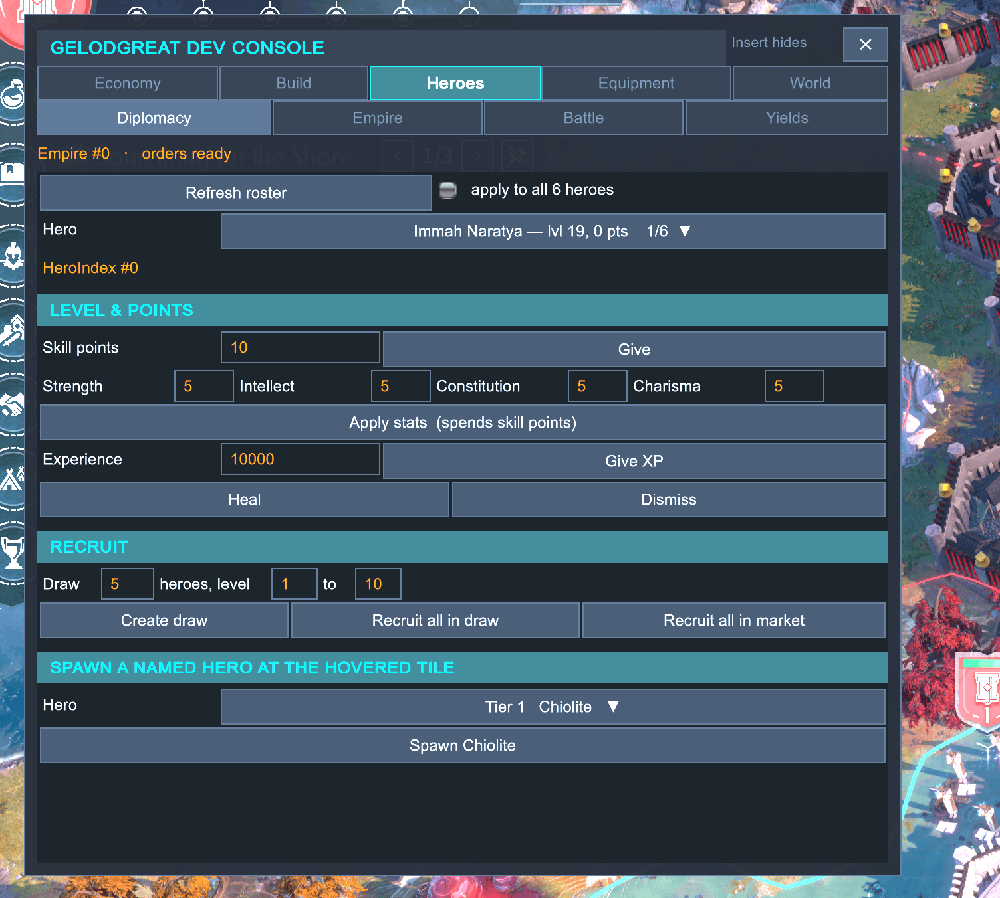
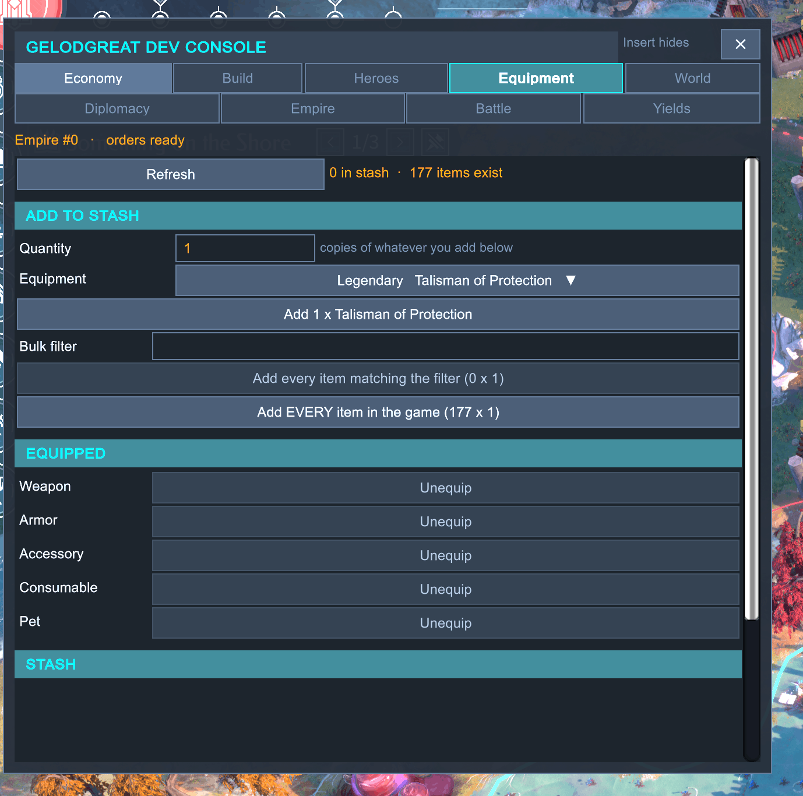
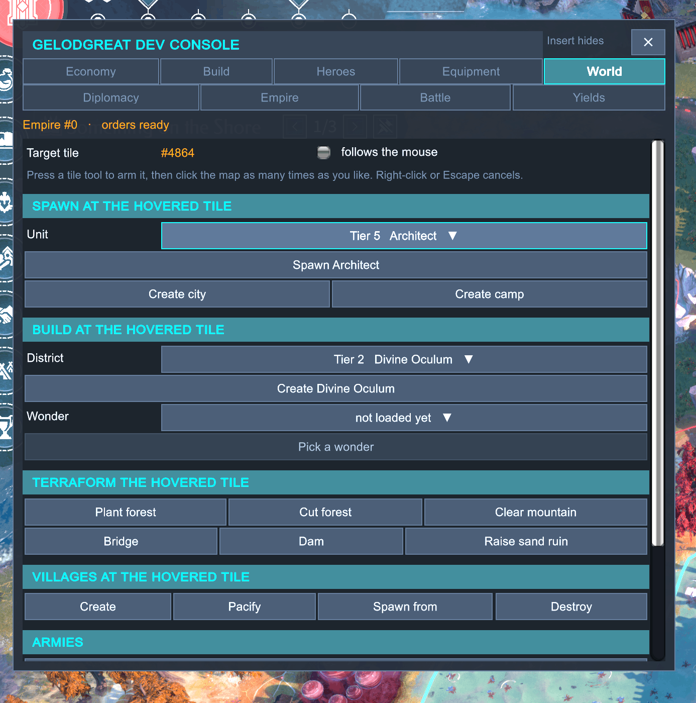
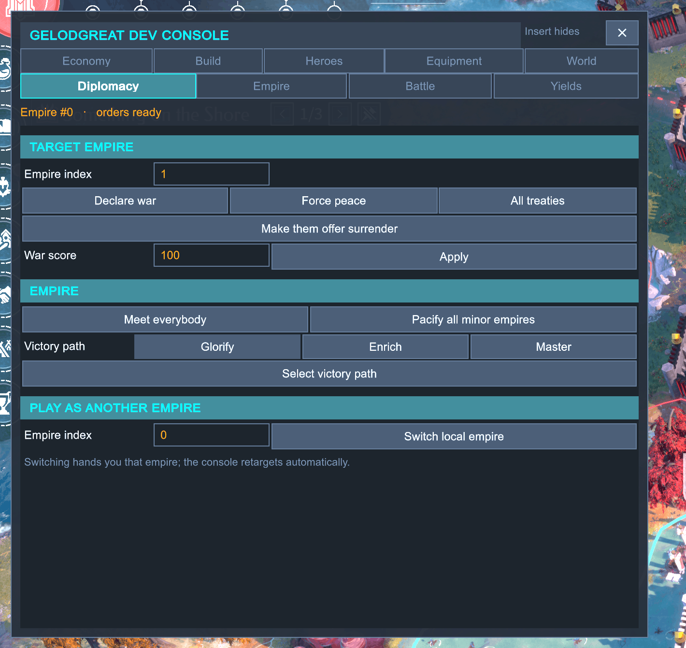
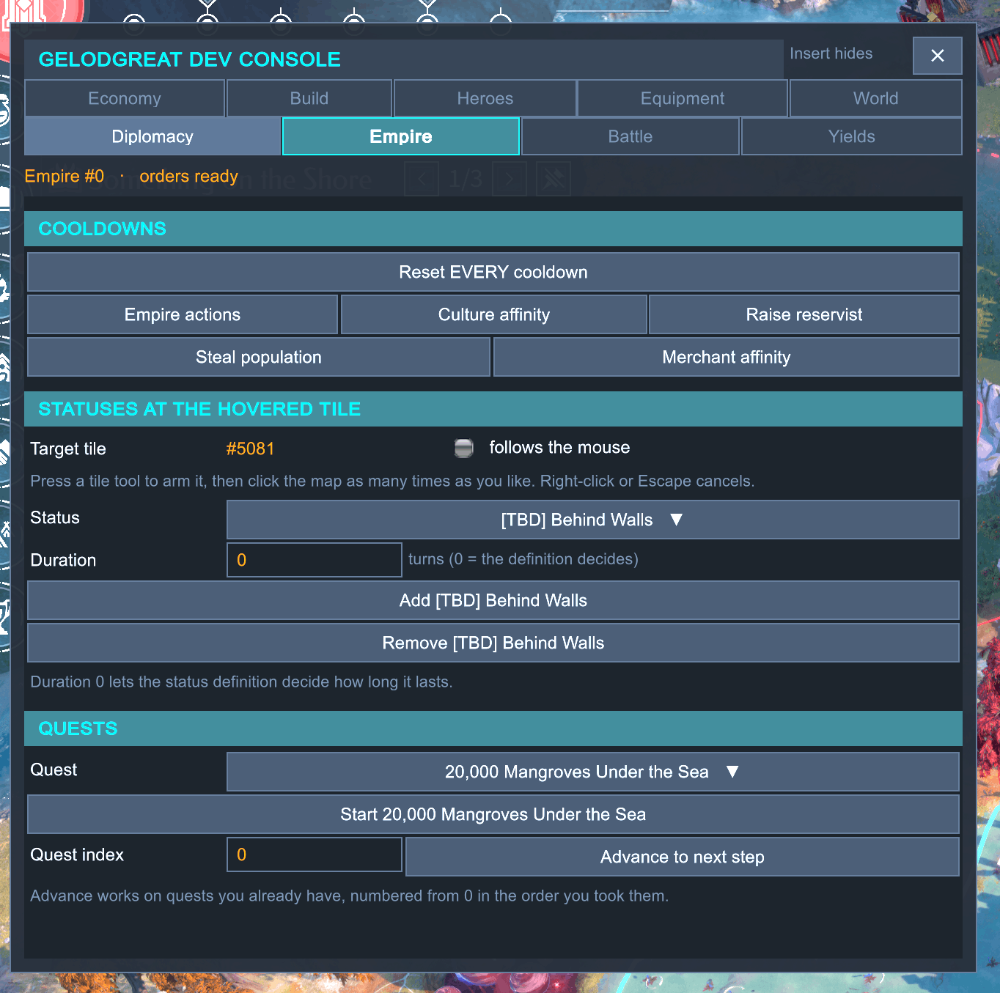
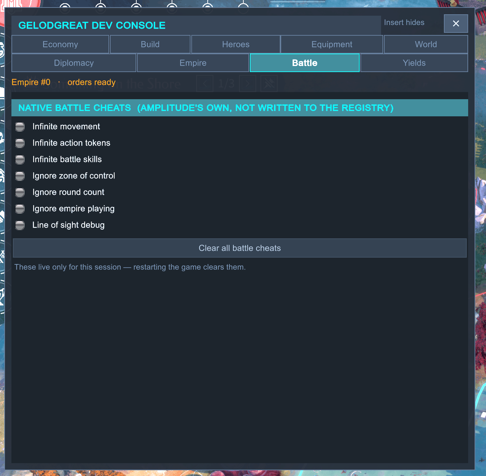
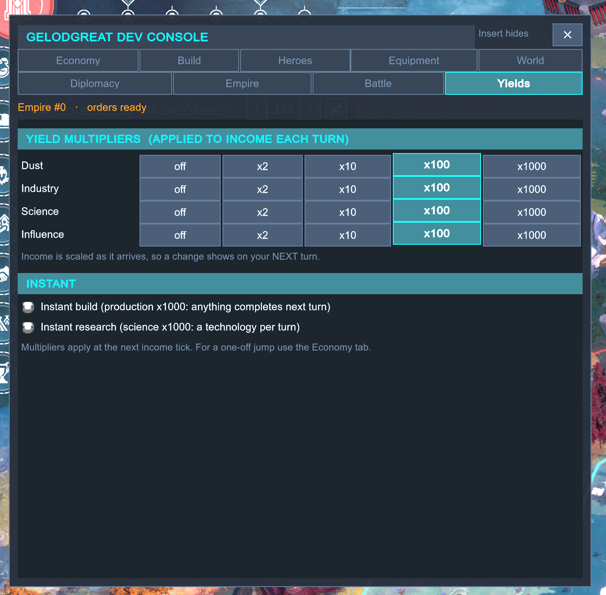

# GeloDGreat Dev Console — ENDLESS LEGEND 2

An in-game developer console for **ENDLESS LEGEND 2**. Press **Insert**, get a window with fourteen tabs: set your
Dust to whatever you like, finish anything in a build queue instantly, hand your heroes levels and Legendary gear,
spawn armies on the tile you're pointing at, force a war, or switch to playing another empire entirely.

**2.0 is Endless Forge**: a world editor and sandbox on top of the console. Place dungeons, curiosities,
observatories and village spawn points; rename, merge or destroy any settlement; add, evolve or damage units in
any army, AI included; send AI armies at a city; start dialogs; and record a run of edits as a **recipe** you can
replay around the capital of your next game. **Ctrl+F** searches every command, and an **edit log** lets you undo
the edits the game has an opposite command for.

It works by using **the game's own developer tools**. Amplitude shipped their in-house map editor in the retail
build — about 110 editor commands — and left it public. The console asks the simulation to do things the same way
their editor did, instead of writing values into memory behind the game's back.

> Unofficial and not affiliated with Amplitude Studios or SEGA. Single-player testing tool — don't use it in
> multiplayer against people who haven't agreed to it.

   

**[Download the latest release](../../releases/latest)** · free and open source, MIT licensed · [report an issue](../../issues)



---

## Install

1. **Install BepInEx 5** (x64, Mono) if you don't already have it — [download it here](https://github.com/BepInEx/BepInEx/releases).
   Extract it into the game folder, the one containing `Endless Legend 2.exe`:
   ```
   .../steamapps/common/ENDLESS Legend 2/
   ```
2. **Run the game once, then quit.** This makes BepInEx create its folders.
3. **Download `DevConsole.zip`** from the [latest release](../../releases/latest).
4. **Extract `DevConsole.dll`** into:
   ```
   .../ENDLESS Legend 2/BepInEx/plugins/
   ```
5. Start the game, load a save, and press **Insert**.

If the window doesn't appear, open `BepInEx/LogOutput.log` and look for `Dev Console` — it logs a line on load and
a line for every action, which is the fastest way to see what happened.

> **Remove any other EL2 cheat plugin first.** The Nexus "EL2 Resource Manager" patches the same income methods and
> running both doubles your multipliers. This plugin refuses to load alongside it.

---

## Using it

**Insert** opens and closes the window. Drag it by the title bar. Everything applies the moment you click — there
is no confirm step.

### Quick

The first tab, and where the switches you flip mid-game live: **infinite movement**, **infinite battle points**,
**infinite battle skills**, **infinite battle** (rounds never run out), plus **instant construction** and **instant
research**. Large ON/OFF switches rather than checkboxes, a one-press _turn everything on/off_, and a count of
what is currently live.

It also gathers the genuinely immediate actions — finish every build queue, unlock every era, add research now —
because the two instant _toggles_ only bite on your next turn, while these apply the moment you press them.
Nothing here is exclusive to this tab; it is a shortcut to controls that also live on Battle, Yields, Build and
Economy.

### Economy

Type a number and press **Set**. These set an absolute value rather than adding, so `1000000` in the Dust box means
you end up with exactly one million.

Resources give you every strategic, luxury, Cadaver and Spirit in one press. Technologies unlock a whole era, or
search for a single one by name.

### Build — instant build, instant recruit, approval, population

Press **Refresh settlements**, pick one, and complete anything in its queue **free and immediately**. Units are
constructions in EL2, so this is how you instantly recruit an army. There is also a button to clear every
settlement's queue at once.

Cities **and camps** both appear here, labelled and counted.

**Population** adds people to the selected settlement, or a specific population kind — with buy-with-money and
buy-with-cadavers shortcuts. **District improvement** places a chosen improvement on the tile you are hovering.
**Unit limits** lifts the one-per-world cap on unique units (the Chosen), and puts it back.

**Approval** sits in the middle of the tab. Each press _adds_ to the city's approval (the game's own
`GodApprovalDelta` cheat field, so it stacks), for the selected city or every city at once. **Clear** resets that
bonus to zero. Unlike the rest of the console this one refreshes the city panel by itself.

### Heroes

Press **Refresh roster** first. Pick a hero from the selector, or tick **apply to all** to hit your whole roster
with the same action.

- **Skill points → Give** tops them up (stat increases spend them, so do this first)
- Fill in the four stat boxes and press **Apply stats**
- **Give XP** to level them, plus **Heal** and **Dismiss**
- **Create draw** generates any number of new heroes at a level range you choose, then **Recruit all in draw**
- **Spawn** any named hero in the game onto the tile your mouse is over

### Equipment

All 177 items, **sorted rarest first** and coloured by rarity. Add one to your stash, or use the bulk filter to add
everything matching a word. Then equip it to the selected hero, or clear the empire's equipment out.

### World

This tab targets **the tile your mouse is hovering over** — the tile number updates live as you move across the
map. Spawn any unit there, found a city or camp, teleport a selected army to it, give an army absurd movement,
reveal the entire map, or collect every curiosity on it.

### Diplomacy

Declare war, force peace, force all treaties, make an empire offer surrender, change war score, meet everybody, and
pick your victory path. **Switch local empire** hands you control of another empire — the console follows you, so
it is a genuine way to inspect what the AI is sitting on.

### Battle

The game's own seven battle cheats: infinite movement, infinite action tokens, infinite battle skills, ignore zone
of control, ignore round count, ignore empire playing, and line-of-sight debug. They last only for the session —
restarting the game clears them.

### Yields

Per-turn multipliers (×2 to ×1000) for Dust, Industry, Science and Influence, plus instant build and instant
research. Unlike everything else these are applied as income arrives, so they show up on your **next turn**, not
immediately. For a one-off jump use the Economy tab.

---

### World › Places (new in 2.0)

Below the original World sections. Every button is a tile tool: press it, then click the map.

- **Curiosities**: place any curiosity, or remove a collectible.
- **Dungeons**: spawn a dungeon or spawn point at a danger level you choose, or remove one.
- **Observatories, burrows, coral**: spawn, evolve to a chosen type, or remove.
- **The Tormented**: create a Tormented army of any type, fill a settlement's Tormented gauge, settle or unsettle.
- **Village spawn points**: add one for any minor faction, or remove it.
- **Terrain extras**: refresh a river, remove a district, set your empire's road quality, force a road update.
- **Curiosity paths** (collapsed): build the paths the Path Curiosity victory uses.

### Settlements (new)

Pick a settlement **on the map** (anyone's) or from your own list. Rename it, make it the capital, turn a camp into
a city, merge another settlement into it or detach a territory, build a foundation, enqueue any district, unit or
improvement at a tile you click, remove queue entries, and change its population. **Destroy** asks for a second
click, because nothing undoes it.

### Units (new)

Pick **any army on the map**, including the AI's. You get its units with their health; add a unit, remove one,
evolve one into its next form, damage every unit, change the army's movement ratio, send it through a burrow to
the exit you click, or destroy it.

### AI & Story (new)

Choose an **acting empire** and an **other empire**, then:

- give any army a mission (attack, explore and the rest) toward a tile you click, or order it to attack a city;
- send a diplomatic mood message, or clear the mood cooldown between two empires;
- start any dialog, clear or regenerate a dungeon, continue a dungeon crawl;
- deploy, dismiss or redistribute heroes, and build a partner den;
- replace a minor faction's trait, set an empire state, make an empire action ready, unlock a council seat;
- enqueue a technology or clear the tech queue.

### Recipes (new)

Press **Start recording**, make your edits, then **Save**. Recipes are JSON files in
`BepInEx/config/forge-recipes/`, so you can share them. **Replay** places every edit in the same shape around the
capital of the game you are in now, so a "fortress start" works on any map. **Same tiles** reuses the recorded
tile numbers for the same map. Steps that fall off the map, or use something your game build lacks, are skipped and
listed in the edit log.

### Search, edit log and self-check

- **Ctrl+F** searches every button in every tab. Enter runs it, or arms it if it is a tile tool. Tab jumps to it.
  Destroy-style commands only jump, so they still need their confirm click.
- The **edit log** under every tab shows what was posted (✓) and what the game rejected (✗), with **Undo** where the
  game has an opposite command: spawned armies, cities, camps, districts, observatories, burrows,
  dungeons, spawn points, curiosities, planted forests, and Dust or Influence you set.
- The status line runs a **self-check** when a game loads: it resolves every game type and member the plugin uses
  on the build you are running, so a game patch that moves something shows up as a count instead of a dead button.

---

## Screenshots

| Build                                                                  | Heroes                                                       |
| ---------------------------------------------------------------------- | ------------------------------------------------------------ |
|                                     |                         |
| Instant build and recruit, approval, population — cities **and camps** | Skill points, stats, XP, draws; one hero or the whole roster |

| Equipment                                       | World                                        |
| ----------------------------------------------- | -------------------------------------------- |
|      |           |
| All 177 items, rarest first, coloured by rarity | Arm a tile tool, then click the map to place |

| Diplomacy                                                  | Empire                                |
| ---------------------------------------------------------- | ------------------------------------- |
|                 |  |
| War, peace, treaties, victory path, play as another empire | Cooldowns, statuses on a tile, quests |

| Battle                                | Yields                                   |
| ------------------------------------- | ---------------------------------------- |
|  |     |
| The game's own seven battle cheats    | Per-turn multipliers and instant toggles |

---

## Settings

Edit `BepInEx/config/angelo.el2.devconsole.cfg`, or delete it to reset:

| Setting         | Default  | What it does                                                                          |
| --------------- | -------- | ------------------------------------------------------------------------------------- |
| `Hotkey`        | `Insert` | Key that opens and closes the window                                                  |
| `SearchHotkey`  | `Ctrl+F` | Opens the command search                                                              |
| `UiScale`       | `0`      | Window scale. `0` picks one from your resolution (×2 at 4K); set a number to override |
| `WindowHeight`  | `520`    | Height of the scrolling area                                                          |
| `NativeOverlay` | `true`   | Unlocks the game's built-in debug overlay (see Known limits)                          |
| `Yields`        | `1`      | The four per-turn multipliers, also on the Yields tab                                 |

---

## Achievements

**This plugin does not disable achievements** — the game cannot see BepInEx plugins at all. Its modded check
(`ModificationManager`) only ever looks at the Steam Workshop directory and the `Modding/` folder.

**Any Workshop or data mod does disable them, though.** When `ModdingUtils.IsModdingEnabled` is true,
`StatisticsReporterAncillary.InitializeOnLoad` returns before registering a single statistic reporter — and EL2
achievements are statistic-driven, so none can ever fire. Unsubscribe from Workshop mods (and check the content
folder actually emptied) if you want achievements. `Player.log` tells you which state you are in:

```
[Modification] Modding is not enabled because no modifications were registered.   ← achievements work
[Modification] Modding is enabled with N active modifications.                    ← achievements off
```

---

## Known limits

- **The Yields multipliers affect console actions too.** Orders are processed asynchronously, so if Science is at
  ×1000 a console "+10,000 research" gets multiplied as well. Set the multipliers to `off` when you want exact
  numbers.
- **Everything caps around 2,147,483.** The simulation uses 32-bit fixed-point maths, so stocks and multiplied
  yields cannot exceed that without overflowing.
- **No item icons.** The game keeps them in a streamed virtual-texture atlas only its own UI shader can draw. Names,
  rarities and rarity colours all work.
- **The native debug overlay does not open.** The plugin unlocks Amplitude's own overlay — `DebugOverlayManager`
  reports itself disabled in retail and the plugin flips that — but **F2 still does not raise it** on V1.0.116,
  because the manager that registers the key never starts. Set `NativeOverlay = false` to skip the patch. The
  Insert window is unaffected either way.
- **Built against V1.0.239.** Every game member is resolved by name and null-checked, so a future patch that renames
  something disables that one control and logs a warning instead of breaking the plugin. The self-check on the
  status line counts anything that moved.
- **No terrain painting.** None of the game's editor commands change a tile's terrain type or elevation, so Forge
  can reshape forests, mountains, rivers and roads but not repaint biomes.
- **Typing in a console field pauses the game's keyboard.** That keeps "wasd" in a search box from moving the
  camera. It comes back the moment the field loses focus.
- Cadavers and Spirits exist only for the factions that use them; those buttons are harmless elsewhere.

---

## Building from source

Requires the [.NET SDK](https://dotnet.microsoft.com/download) and a copy of the game — it references the game's
assemblies at compile time, and none of them are redistributed here.

```bash
python tools/build_plugin.py                 # build and install into BepInEx/plugins
python tools/build_plugin.py --no-install    # build only
```

If the game is not at the default path:

```bash
python tools/build_plugin.py --game-dir "D:/SteamLibrary/steamapps/common/ENDLESS Legend 2"
```

### How it is put together

**Writes go through the game's order system.** `Amplitude.Mercury.Interop` holds ~110 public `EditorOrder*` types
plus the god/cheat orders, and `SandboxManager.PostOrder` enqueues them onto a thread-safe queue the simulation
drains and validates. That is the whole of `Orders.cs`.

**Reads use reflection**, because `Sandbox`, `Empire`, `Hero`, `Settlement` and `Army` are all `internal`. `Sim.cs`
is that bridge.

Two things are not orders. The yield multipliers are Harmony patches on the `Gain*` methods, because no order scales
per-turn income. The battle cheats call `BattleDebug.SetCheat` directly with `writeRegistry: false`.

Names and rarities come from the live datatables: each definition is paired with its `UIMapper` by element name and
the mapper's `%Key` title resolved through `ILocalizationService`, so lists follow your language and pick up
anything a data mod adds.

```
plugin/DevConsole/
  Plugin.cs        entry point, hotkeys
  Orders.cs        order dispatch          Sim.cs, SimWorld.cs   reflection reads
  Catalog.cs       names, rarities, sort   Patches.cs            yield multipliers
  Edits.cs         edit log and undo       OrderCodec.cs         order <-> plain record
  Commands.cs      search index            SelfCheck.cs          game-reference check
  InputGuard.cs    keyboard pause while typing
  DebugOverlay.cs  native overlay unlock
  Cheats/          one file per tab's actions, plus Recipes.cs
  Ui/              Theme.cs, Widgets.cs, Window.cs, SearchPalette.cs, EditLogStrip.cs, one Tab*.cs per tab
plugin/Forge.Core/ game-free logic compiled into the same DLL: hex grid, recipe format, undo table, search, log
tests/             xUnit tests for Forge.Core (dotnet test tests/Forge.Core.Tests)
tools/             build and install scripts
mod/DevConsole/    a separate data-only mod (see below)
docs/plans/        design notes and the research behind it
```

---

## The data-mod variant

`mod/DevConsole/` is a **separate** version built only from the official JSON modding path — no code injection, so
it could be shared on the Steam Workshop. It is far more limited: the console appears as an every-turn event dialog
with at most four buttons per page, and each action needs a confirm click.

The plugin replaces it. Use this only if you specifically need a no-injection mod:

```bash
python tools/install_mod.py --source mod/DevConsole    # install
python tools/install_mod.py --uninstall                # remove
```

Start a **new game** after installing or removing it — saves keep references to its elements.

---

## License

MIT — see [LICENSE](LICENSE). Unofficial; ENDLESS LEGEND is a trademark of Amplitude Studios / SEGA. No game assets
are redistributed in this repository.
